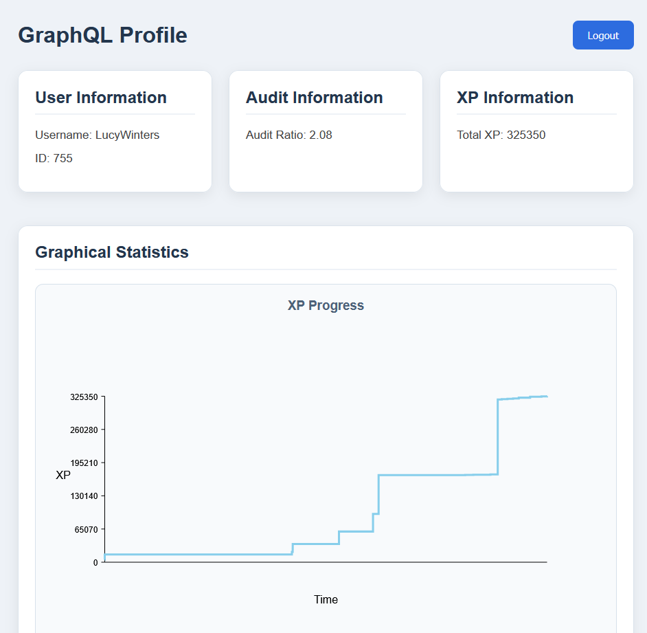
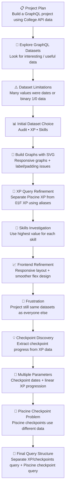

###### GraphQL Profile Dashboard

A graphQL profile dashboard built with JavaScript, HTML, CSS, and GraphQL.

The application uses GraphQL to retrieve user data and presents it through statistics and interactive graphs, allowing users to view their XP, audit ratio, skills, and exam progress in one place.

###### Table of Contents

Demo
Features
Tech Stack
Design Process
Installation
Usage
How To Run
Future Improvements
License

## Demo



###### Features

* Display user ID
* Display total XP
* Display audit ratio
* XP progression over time graph
* Skills graph
* Exam progress graph
* GraphQL queries for retrieving user data
* Dynamic data visualisation
* Clean dashboard interface

###### Tech Stack

* Frontend: HTML, CSS, JavaScript
* Data: GraphQL
* Visualisation: JavaScript svg graphs
* Authentication: GraphQL authentication

GraphQL was chosen to efficiently retrieve the specific user data required by the dashboard without requesting unnecessary information.

JavaScript was used to process the GraphQL responses and dynamically generate the dashboard and data visualisations.

HTML and CSS provide the structure and styling for the dashboard while keeping the project lightweight and easy to run.

###### Design Process



## Design Process 1. Finding Useful Data

The original plan was to create a GraphQL project using data from the college API. As we were given a choice of which data to use, I explored the available GraphQL datasets looking for something that would produce interesting visualisations.

Unfortunately, many of the datasets consisted primarily of dates or binary `1`/`0` values. This made them difficult to visualise meaningfully or use for interesting analysis.

I initially resigned myself to using the same datasets that many other projects were using: Audit, XP, and Skills.

## Design Process 2. Building the Graphs

The graphs were built using SVG, allowing the visualisations to be generated dynamically from the GraphQL data.

One of the main challenges was making the graphs responsive. The graphs needed to resize with the page without labels being cut off or overlapping the graph itself. Padding and label positioning therefore required quite a bit of fine-tuning.

The frontend was also adjusted to make the layout responsive, with the flex-based page structure being refined until the graphs remained usable at different screen sizes.

## Design Process 3. Investigating the XP Data

While working on the XP graph, I discovered that the standard XP query also included Piscine XP.

This didn't match the XP totals used for the 01F progression, so the query needed to be refined using GraphQL aliases to separate the different XP sources.

## Design Process 4. Understanding Skills

The skills data also required some investigation.

Rather than simply adding together every individual skill entry, the relevant value for each skill was the highest individual value recorded.

For example, a skill with several progression entries could initially appear to have a much larger total, while the actual progression value was based on the highest recorded value.

This also revealed an unusual limitation with the Git skill. The maximum recorded value is only 50%, because there is currently only one project contributing to that skill and it provides 50%.

This suggests that some skills may have progression caps below 100%, rather than every skill necessarily being designed to reach 100%.

## Design Process 5. Finding Something More Interesting

After finishing the initial graphs, I was frustrated that I had ultimately ended up using the same datasets as most other projects.

While explaining this frustration to someone, I realised that the XP data could potentially be used to extract exam checkpoint progression.

By querying XP using multiple parameters, I could identify XP increases associated with individual checkpoints. Since the checkpoints also have dates attached to them, and XP progression is linear based on question number, this made it possible to estimate how far a user had progressed through each exam.

This provided a much more interesting dataset to visualise.

## Design Process 6. The Piscine Complication

There was one final complication: the checkpoints inside the Piscine are not actually identified using the same `checkpoint` parameter.
This meant that the Piscine checkpoints required their own specific query parameter.

As a result, the original XP problem returned: the normal XP query included Piscine XP, while the checkpoint queries needed to distinguish between the two systems.

The final solution therefore uses two seperate xp query aliases

* One query for normal XP and standard checkpoints
* One query specifically for Piscine checkpoints

This allowed the project to combine the different sources of data into a more complete picture of the user's progression.


###### Installation

```bash
git clone <repository-url>
cd <project-directory>
```
No backend or database setup is required.

###### How To Run

Open the project in your browser or use a local development server.
Eg, VS Code's Live Server extension, open the project and launch `index.html`.

Then navigate through the dashboard to view the user's:

* ID
* XP
* Audit ratio
* XP progression
* Skills
* Exam progress

###### Future Improvements

* Improved dashboard styling
* More detailed skill breakdowns
* Additional XP statistics
* More detailed exam information
* Responsive mobile layout
* User profile customisation
* Additional data visualisations
* Dark mode
* Improved error handling

###### License

MIT License © 2026 Lucy Winters

